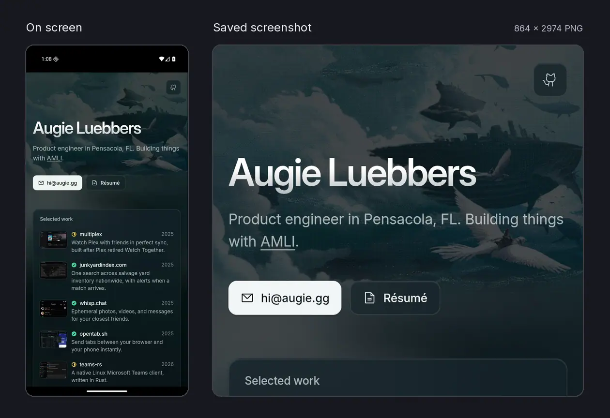

  
  <h1>Longshot</h1>
  
Capture a scrolling page as one lossless PNG on Android 14 and later.

  
<a href="#use-it">Get started</a> · <a href="docs/media/setup-guide.mp4">Watch the setup guide</a>

  

## Use it

1. **Enable Longshot.** Tap **Open accessibility settings**, select **Longshot**, turn on **Use Longshot**, and tap **Allow**. If Android blocks the switch, tap **Seeing “Restricted setting”?** in Longshot to open App info.
2. **Start a capture.** Add the **Longshot** tile to Quick Settings. On the page you want, tap the tile, close the shade, and tap **Capture**. You can also use **Show capture controls** in Longshot.
3. **Extend the screenshot.** Tap **More** for the next section, or hold it to keep scrolling. Tap **Stop** to end continuous capture after the current step.
4. **Save and share.** Tap **Save**, then tap the thumbnail to open the image, **Edit** to mark it up, or **Share** to send it. The PNG stays on your device in `Pictures/Longshot`.

### Pixel Quick Tap

On a supported Pixel, Longshot opens Quick Tap settings after accessibility setup. You can also tap **Quick Tap** in Longshot. Turn it on, choose **Open app**, tap the gear beside **Open app**, then the gear beside **Longshot**, and select **Capture current page**. Double-tap the back of the unlocked phone to capture the first frame automatically. Power and Volume Down still open Pixel’s system screenshot toolbar.

The setup video uses an Android emulator to demonstrate the Quick Tap settings and simulate the back-tap gesture.

## Capture limits

Longshot captures the selected app window, including pinned content. Android blocks screenshots of protected windows. To extend the image, the app needs an accessible vertical scroll area and a measurable scroll distance. If a custom view or independently scrolling pane stops reporting movement, you can save the portion already captured. The working image limit is 192 MiB of RGB scanlines.

## Build

With JDK 17 and Android SDK 35 installed, run `./gradlew assembleDebug testDebugUnitTest lintDebug`. The development APK is under `app/build/outputs/apk/debug/`.

Tests and device verification

Automated tests cover guided setup, saved-image intents and URI permissions, nested scroll areas, directional actions, bottom offsets, shortcut task flags, service reconnection, accumulated deltas, absolute offsets, child identities and positions, changing viewport origins, conflicting measurements, and PNG export. The export test reconstructs a five-frame page, compares every decoded pixel with the source, and checks that invalid extensions preserve the captured image. On a physical Pixel 8 Pro, the Quick Tap diagnostic triggered the first capture on the System settings page, left that same activity in the foreground, and displayed More, Save, and Discard. Version 0.3.1 was also tested from the top of augie.gg in Chrome on the Pixel 8 Pro. Two More taps produced a 1344 × 4612 PNG. The saved footer stats and artwork credit matched their on-screen pixels. Version 0.4.1 was verified on the same Pixel in Android System settings and Chrome. More stayed available through the collapsing settings header and disappeared at Reset options. On augie.gg, two taps reached the footer, which matched the saved PNG.

How scroll capture works on Samsung and Android

### Samsung Smart Capture

I inspected Smart Capture 5.7.43.5 from Galaxy A14 Android 14 firmware. Android's APK signature verifier identified the signer certificate as Samsung Cert. JADX recovered the scroll manager, information extractor, gesture injector, and image composer. The APK SHA-256 was `30b9647da47922e271527ebed66dd4a1a1797304dedf51abf804ea76769a315b`. [Firmware APK](https://github.com/Firmware-Dumper/samsung_a14_dump/blob/d84c52fb15ca690e37956caec965765821c75a6b/system/system/app/SmartCapture/SmartCapture.apk)

Samsung documents the repeat-tap and long-press controls. In the inspected One UI System UI code, the screenshot task sends the capture service a screenshot-start notification. [Samsung user guide](https://www.samsung.com/uk/support/mobile-devices/how-to-use-scroll-capture-on-a-galaxy-smartphone/) · [System UI screenshot task](https://github.com/488315/samsung_framework/blob/30cd25b68f67be792ab78fb46fb9f63af0964522/SystemUI-Jadx/sources/com/android/systemui/screenshot/SaveImageInBackgroundTask.java)

In the A14 APK, `ScrollInfoExtractor` queries Samsung's `SemRemoteAppDataExtractionManager` for scrollable view geometry, and `TouchEventInjectionManager` uses that manager to send touches. `ScrollCaptureManager` uses an estimated scroll distance when available. Its image-matching path calls `ScrollCaptureComposer.nativeFindOverlappedArea` in `libJniScrollCapture.so`, then joins the captures inside their overlap. Samsung's framework checks permissions for its remote view queries and input injection. [Framework dispatcher](https://github.com/488315/samsung_framework/blob/30cd25b68f67be792ab78fb46fb9f63af0964522/framework/sources/com/samsung/android/content/smartclip/SmartClipRemoteRequestDispatcher.java)

### How Longshot measures scrolling

I decompiled the One UI client and dispatcher from the published framework JAR and the distance estimator from the Galaxy A14 APK. The client forwards requests to Samsung’s S Pen gesture service. That service checks permission and routes a request through WindowManager to the target process. There, the dispatcher reads the actual view hierarchy, including child identities and screen bounds, and reads `WebView.getScrollY()` for WebViews. In the A14 capture app, `ScrollableAreaDetector.estimateScrolledHeight` follows a child across a swipe and subtracts its new top from its old top. [Framework binary](https://github.com/488315/samsung_framework/blob/30cd25b68f67be792ab78fb46fb9f63af0964522/framework.jar) · [System service](https://github.com/488315/samsung_framework/blob/30cd25b68f67be792ab78fb46fb9f63af0964522/services/sources/com/android/server/smartclip/SpenGestureManagerService.java)

LSPatch operates on each APK it patches. Applying it to Longshot alone would leave the Pixel system service and the target apps without Samsung’s request handlers. Version 0.2 implements the child-displacement calculation with Android accessibility nodes and uses the selected node’s scroll events to obtain pixel deltas or successive absolute positions. It requires two identifiable children at distinct positions to agree when using child geometry. It uses the measured displacement to join screenshots, with no image matching. Missing or contradictory measurements end the scroll session and leave the captured portion available to save. [Android scroll event fields](https://developer.android.com/reference/android/view/accessibility/AccessibilityRecord#getScrollDeltaY()) · [LSPatch scope](https://github.com/LSPosed/LSPatch#introduction)

