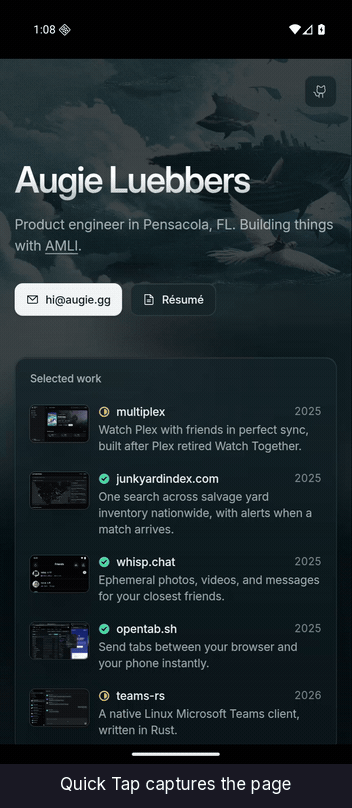

# Longshot for Pixel

Longshot captures a vertically scrolling app window on Android 14 or later. It runs locally and saves one lossless PNG to `Pictures/Longshot`.

## Use it

[Watch the narrated setup guide (MP4)](docs/media/setup-guide.mp4) to enable accessibility, choose **Capture current page** in Pixel Quick Tap, and capture a website. The emulator simulates the back-tap gesture.

1. Open Longshot and tap **Open accessibility settings**. Select **Longshot**, turn on **Use Longshot**, and tap **Allow**. If Android blocks the switch, return to Longshot and tap **Seeing “Restricted setting”?** for a shortcut to its App info page.
2. On a Pixel with Quick Tap, return to Longshot after enabling accessibility to open Quick Tap settings automatically. You can also tap **Quick Tap** in Longshot at any time. Turn on Quick Tap, choose **Open app**, tap its gear, then tap the gear beside **Longshot** and select **Capture current page**. Double-tap the back of the unlocked phone while viewing the page you want.
3. Quick Tap captures the first frame automatically. From Longshot’s main screen or Quick Settings tile, you can also show the controls and tap **Capture** manually. Tap **More** for each additional section, or hold **More** to start continuous capture. **Stop** ends continuous capture after the current step.
4. Tap **Save** to write the image. Tap the thumbnail to open it, **Edit** to mark it up, or **Share** to send it using the Android sharesheet. The card closes automatically, and the PNG stays in Pictures/Longshot. If the page ends or the app stops reporting usable scroll geometry, you can save everything captured so far.

Pixel’s power and volume shortcut still opens the system screenshot toolbar. Longshot starts from Quick Tap, its own controls, or its tile. It captures the selected app window, including pinned content within that window. Android blocks screenshots of protected windows. The scrolling path needs a visible accessibility scroll area and a measurable vertical displacement. Custom-drawn apps and independently scrolling panes may stop after the first frame. The working image limit is 192 MiB of RGB scanlines.

## What Samsung does

I inspected Smart Capture 5.7.43.5 from Galaxy A14 Android 14 firmware. Android's APK signature verifier identified the signer certificate as Samsung Cert. JADX recovered the scroll manager, information extractor, gesture injector, and image composer. The APK SHA-256 was `30b9647da47922e271527ebed66dd4a1a1797304dedf51abf804ea76769a315b`. [Firmware APK](https://github.com/Firmware-Dumper/samsung_a14_dump/blob/d84c52fb15ca690e37956caec965765821c75a6b/system/system/app/SmartCapture/SmartCapture.apk)

Samsung documents the repeat-tap and long-press controls. In the inspected One UI System UI code, the screenshot task sends the capture service a screenshot-start notification. [Samsung user guide](https://www.samsung.com/uk/support/mobile-devices/how-to-use-scroll-capture-on-a-galaxy-smartphone/) · [System UI screenshot task](https://github.com/488315/samsung_framework/blob/30cd25b68f67be792ab78fb46fb9f63af0964522/SystemUI-Jadx/sources/com/android/systemui/screenshot/SaveImageInBackgroundTask.java)

In the A14 APK, `ScrollInfoExtractor` queries Samsung's `SemRemoteAppDataExtractionManager` for scrollable view geometry, and `TouchEventInjectionManager` uses that manager to send touches. `ScrollCaptureManager` uses an estimated scroll distance when available. Its image-matching path calls `ScrollCaptureComposer.nativeFindOverlappedArea` in `libJniScrollCapture.so`, then joins the captures inside their overlap. Samsung's framework checks permissions for its remote view queries and input injection. [Framework dispatcher](https://github.com/488315/samsung_framework/blob/30cd25b68f67be792ab78fb46fb9f63af0964522/framework/sources/com/samsung/android/content/smartclip/SmartClipRemoteRequestDispatcher.java)

## What runs on a stock Pixel

I decompiled the One UI client and dispatcher from the published framework JAR and the distance estimator from the Galaxy A14 APK. The client forwards requests to Samsung’s S Pen gesture service. That service checks permission and routes a request through WindowManager to the target process. There, the dispatcher reads the actual view hierarchy, including child identities and screen bounds, and reads `WebView.getScrollY()` for WebViews. In the A14 capture app, `ScrollableAreaDetector.estimateScrolledHeight` follows a child across a swipe and subtracts its new top from its old top. [Framework binary](https://github.com/488315/samsung_framework/blob/30cd25b68f67be792ab78fb46fb9f63af0964522/framework.jar) · [System service](https://github.com/488315/samsung_framework/blob/30cd25b68f67be792ab78fb46fb9f63af0964522/services/sources/com/android/server/smartclip/SpenGestureManagerService.java)

LSPatch operates on each APK it patches. Applying it to Longshot alone would leave the Pixel system service and the target apps without Samsung’s request handlers. Version 0.2 implements the child-displacement calculation with Android accessibility nodes and uses the selected node’s scroll events to obtain pixel deltas or successive absolute positions. It requires two identifiable children at distinct positions to agree when using child geometry. It uses the measured displacement to join screenshots, with no image matching. Missing or contradictory measurements end the scroll session and leave the captured portion available to save. [Android scroll event fields](https://developer.android.com/reference/android/view/accessibility/AccessibilityRecord#getScrollDeltaY()) · [LSPatch scope](https://github.com/LSPosed/LSPatch#introduction)

## Build and verification

With JDK 17 and Android SDK 35 installed, run `./gradlew assembleDebug testDebugUnitTest lintDebug`. The development APK is under `app/build/outputs/apk/debug/`.

Automated tests cover guided setup, saved-image intents and URI permissions, nested scroll areas, directional actions, bottom offsets, shortcut task flags, service reconnection, accumulated deltas, absolute offsets, child identities and positions, changing viewport origins, conflicting measurements, and PNG export. The export test reconstructs a five-frame page, compares every decoded pixel with the source, and checks that invalid extensions preserve the captured image. On a physical Pixel 8 Pro, the Quick Tap diagnostic triggered the first capture on the System settings page, left that same activity in the foreground, and displayed More, Save, and Discard. Version 0.3.1 was also tested from the top of augie.gg in Chrome on the Pixel 8 Pro. Two More taps produced a 1344 × 4612 PNG. The saved footer stats and artwork credit matched their on-screen pixels. Version 0.4.1 was verified on the same Pixel in Android System settings and Chrome. More stayed available through the collapsing settings header and disappeared at Reset options. On augie.gg, two taps reached the footer, which matched the saved PNG.
